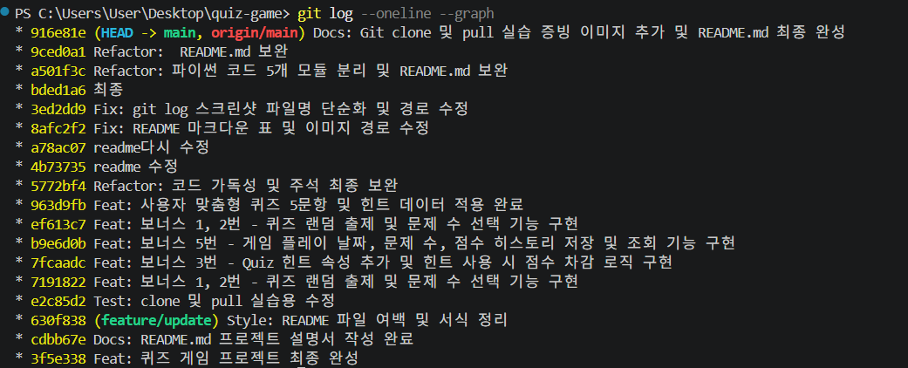
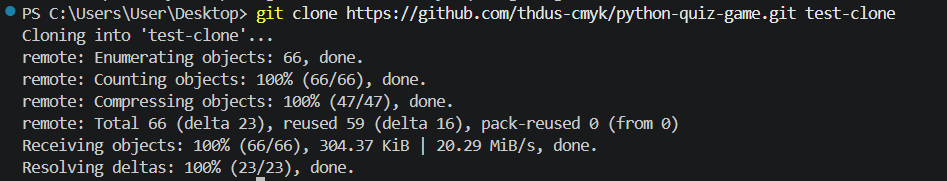
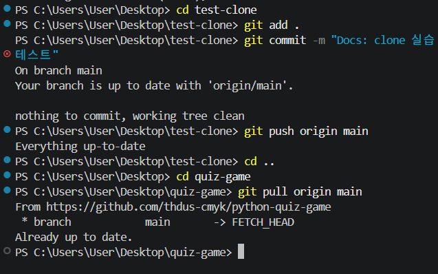

# 🎯 파이썬 콘솔 기반 인터랙티브 퀴즈 게임 (Console Quiz Game)

> 객체지향 설계(OOP)와 모듈화, JSON 파일 입출력을 활용한 사용자 맞춤형 퀴즈 게임 프로젝트입니다.

---

## 📑 목차 (Table of Contents)
1. [프로젝트 개요 및 개발 환경](#1-프로젝트-개요-및-개발-환경)
2. [퀴즈 주제 및 문항 구성](#2-퀴즈-주제-및-문항-구성)
3. [주요 기능 및 점수 계산 규칙](#3-주요-기능-및-점수-계산-규칙)
4. [설치, clone 및 실행 방법](#4-설치-clone-및-실행-방법)
5. [모듈화 파일 구조 및 역할](#5-모듈화-파일-구조-및-역할)
6. [데이터 저장 구조 및 저장 방식의 한계](#6-데이터-저장-구조-및-저장-방식의-한계)
7. [프로그램 전체 실행 증빙 화면](#7-프로그램-전체-실행-증빙-화면)
8. [Git 커밋 컨벤션, 그래프 및 실습 증빙](#8-git-커밋-컨벤션-그래프-및-실습-증빙)
9. [객체지향 설계(OOP) 및 모듈화 적용 이유](#9-객체지향-설계oop-및-모듈화-적용-이유)
10. [유지보수 영향 분석 체크리스트](#10-유지보수-영향-분석-체크리스트)

---

## 1. 프로젝트 개요 및 개발 환경

### 프로젝트 개요
파이썬의 기본 데이터 구조와 조건문/반복문을 넘어서, **모듈화를 통한 단일 책임 원칙 적용**, **객체지향 프로그래밍(OOP)**, **JSON 기반의 데이터 영속성 관리**를 실습하기 위해 개발되었습니다. 퀴즈 풀기, 사용자 문항 추가/삭제, 플레이 기록 추적 기능을 제공하며 Git 버전 관리를 적용했습니다.

### 개발 환경 설정 증빙

| VSCode 개발 환경 구성 (1) | VSCode 터미널 및 파이썬 환경 (2) |
| :---: | :---: |
|  |  |
| *VSCode 워크스페이스 구성* | *Python 3.11 및 Git 설정 확인* |

- **Language**: Python 3.11.6
- **IDE**: Visual Studio Code
- **Version Control**: Git / GitHub
- **Dependencies**: 파이썬 표준 라이브러리 사용 (`json`, `os`, `random`, `datetime`)

---

## 2. 퀴즈 주제 및 문항 구성

- **주제**: 일상 상식, 지역 및 대중문화, 넌센스 센스 퀴즈
- **선정 이유**: 누구나 직관적으로 접근할 수 있는 소재로 플레이어의 흥미를 높이고, 4지선다 객관식 구조로 명확한 입출력 검증이 가능하여 선정했습니다.
- **기본 문항 (5종)**:
  1. 강아지 성향 퀴즈
  2. 성심당 메뉴 퀴즈
  3. 빛의 삼원색 구분 퀴즈
  4. 대전 출신 연예인 퀴즈
  5. 속담 완성 퀴즈

---

## 3. 주요 기능 및 점수 계산 규칙

### 메뉴 구성 명세
*(💡 각 기능 이름을 클릭하면 실행 화면 스크린샷 위치로 바로 이동합니다.)*

| 메뉴 | 기능 | 설명 |
| :---: | --- | --- |
| **1** | [퀴즈 풀기](#img-quiz-play) | 문항 랜덤 추출, 풀 문제 수 지정, 힌트 요청 (`h`), 정답 채점 |
| **2** | [퀴즈 추가](#img-quiz-add) | 질문, 선택지 4개, 정답 번호, 힌트 텍스트 입력 및 저장 |
| **3** | [퀴즈 삭제](#img-quiz-delete) | 목록 번호를 선택하여 해당 퀴즈 삭제 및 파일 즉시 반영 |
| **4** | [퀴즈 목록](#img-quiz-list) | 현재 등록된 전체 문제와 힌트 내용 조회 |
| **5** | [점수 및 히스토리](#img-quiz-history) | 최고 점수 갱신 확인 및 누적 플레이 기록 최신순/순차 조회 |
| **6** | [종료](#img-quiz-exit) | 안전하게 데이터 저장 후 프로그램 종료 |

### 점수 환산 공식 (100점 만점 기준)
- **힌트 없이 정답**: 문제당 1.0점
- **힌트 사용 후 정답 (`h` 입력)**: 문제당 0.5점 (50% 차감)
- **오답**: 0점

$$\text{최종 환산 점수} = \left( \frac{\text{획득한 총 배점}}{\text{출제 문제 수}} \right) \times 100$$

---

## 4. 설치, clone 및 실행 방법

### GitHub 저장소 복제 (Git Clone)
```bash
git clone https://github.com/thdus-cmyk/python-quiz-game.git
cd python-quiz-game
```

### 프로그램 실행
```bash
python main.py
```

---

## 5. 모듈화 파일 구조 및 역할

```text
quiz-game/
├── main.py              # 메인 루프 및 메뉴 선택 실행 진입점
├── quiz.py              # Quiz 클래스 (개별 문제 데이터 및 정답 판정)
├── quiz_game.py         # QuizGame 클래스 (전체 상태 및 JSON 입출력)
├── quiz_play.py         # play_quiz() 함수 (랜덤 출제, 힌트 감점 및 점수 계산)
├── default_quizzes.py   # 초기 데이터 복구용 기본 퀴즈 5개
├── state.json           # 퀴즈 목록, 최고 점수, 히스토리 저장용 JSON
├── .gitignore           # Git 추적 제외 설정
└── README.md            # 프로젝트 명세 문서
```

| 파일명 | 담당 역할 |
| --- | --- |
| `main.py` | 사용자 콘솔 인터페이스 및 1~6번 메뉴 핸들링 |
| `quiz.py` | 개별 퀴즈 정보 캡슐화 (`Quiz` 클래스) |
| `quiz_game.py` | 퀴즈 목록/히스토리 관리, `state.json` 읽기/쓰기, C.R.U.D 처리 |
| `quiz_play.py` | 퀴즈 진행 제어, 랜덤 샘플링, 힌트 분기 및 환산 점수 계산 |
| `default_quizzes.py` | 최초 실행 시 데이터 생성용 기본 퀴즈 정의 함수 |
| `state.json` | 퀴즈 정보와 플레이 기록 저장을 담당하는 데이터 파일 |

---

## 6. 데이터 저장 구조 및 저장 방식의 한계

### JSON 데이터 스키마 (`state.json`)
```json
{
    "quizzes": [
        {
            "question": "다음 중 가장 성격이 나쁜 강아지는?",
            "choices": ["골든 리트리버", "시츄", "치와와", "사모예드"],
            "answer": 3,
            "hint": "작고 눈이 똥그란 소형견입니다."
        }
    ],
    "best_score": 100,
    "history": [
        {
            "date": "2026-11-08 15:30:00",
            "total": 5,
            "score": 100
        }
    ]
}
```

### JSON 저장 방식의 기술적 한계 및 개선 방향
1. **전체 직렬화 오버헤드**: 문제 하나 추가/삭제 시에도 파일 전체를 다시 쓰므로 데이터 크기가 증가할수록 입출력 성능이 떨어집니다.
2. **동시성 및 트랜잭션 미지원**: 여러 사용자가 동시에 입출력을 수행할 경우 파일 충돌 위험이 존재합니다.
3. **향후 발전 방향**: 데이터 규모 확장 시 파일 기반 관계형 데이터베이스인 **SQLite**로 전환하여 부분 업데이트 및 쿼리 조회를 적용하는 것이 바람직합니다.

---

## 7. 프로그램 전체 실행 증빙 화면

### ① 퀴즈 조회 및 정답 풀이
<a id="img-quiz-list"></a>
<a id="img-quiz-play"></a>

| 퀴즈 목록 조회 | 퀴즈 정답 맞추기 플레이 |
| :---: | :---: |
|  |  |
| *등록된 문제 및 힌트 확인* | *문제 수 선택 및 풀이 진행* |

### ② 힌트 활용 및 만점 달성
| 힌트 요청 및 감점 처리 | 전문항 정답 달성 및 최고점 갱신 |
| :---: | :---: |
|  |  |
| *'h' 입력 시 힌트 출력 및 0.5점 감점* | *최고 점수 갱신 연출* |

### ③ 문제 관리 (추가 및 삭제)
<a id="img-quiz-add"></a>
<a id="img-quiz-delete"></a>

| 퀴즈 추가 | 퀴즈 삭제 |
| :---: | :---: |
|  |  |
| *새로운 질문/선택지/힌트 등록* | *선택 번호 기반 퀴즈 제거* |

### ④ 기록 확인 및 정상 종료
<a id="img-quiz-history"></a>
<a id="img-quiz-exit"></a>

| 점수 및 플레이 히스토리 | 프로그램 정상 종료 |
| :---: | :---: |
|  |  |
| *일시별 기록 최신순/누적 조회* | *메뉴 6번 입력 시 안전한 저장 및 종료* |

---

## 8. Git 커밋 컨벤션, 그래프 및 실습 증빙
2026년 11월 8일 기준으로, GitHub main 브랜치에는 총 19개의 커밋이 존재합니다. 따라서 과제에서 요구하는 10개 이상의 커밋 조건을 충족합니다.

### 8.1 커밋 메시지 규칙 및 수량
- **커밋 수 확인 명령어**: `git rev-list --count HEAD` (10개 이상 충족)
- **로그 확인 명령어**: `git log --oneline --graph`

전체 커밋 이력: [GitHub Commits](https://github.com/thdus-cmyk/python-quiz-game/commits/main)

| 커밋 태그 | 의미 및 용도 | 예시 |
| :---: | --- | --- |
| **Feat** | 새로운 기능 구현 | `Feat: 힌트 보기 및 0.5점 감점 로직 추가` |
| **Fix** | 입력 오류 및 버그 수정 | `Fix: 퀴즈 풀기 예외 입력 시 예외 처리` |
| **Refactor** | 코드 구조 개편 | `Refactor: main.py 코드를 5개 모듈로 분리` |
| **Docs** | 문서 및 스크린샷 갱신 | `Docs: README.md 모듈화 명세 업데이트` |
| **Chore** | 기타 설정 및 Git 관리 | `Chore: state.json 파일 .gitignore 반영` |

### 8.2 Git Log Graph 증빙
 feature 브랜치 분기 및 병합, 기능 단위의 10개 이상 커밋 이력을 나타내는 그래프입니다.

| Git Commit History Graph |
| :---: |
|  |
| *`git log --oneline --graph` 실행 결과* |

### 8.3 Git Clone 및 Pull 실습 증빙
원격 저장소(GitHub)를 별도 디렉터리에 복제(`clone`)하고, 소스 수정 후 `push` 및 `pull`을 실행하여 다중 환경 동기화를 검증했습니다.

| Git Clone 실습 증빙 | Git Clone 및 Pull 실습 증빙 |
| :---: | :---: |
|  |  |
| *`git clone` 명령 실행 결과* | *`git pull` 실행 및 최신화 결과* |

---

## 9. 객체지향 설계(OOP) 및 모듈화 적용 이유

### 9.1 핵심 클래스 구조 (Class Architecture)

| 클래스명 | 담당 역할 | 주요 속성 (Attributes) | 주요 메서드 (Methods) |
| :---: | --- | --- | --- |
| **`Quiz`** | 개별 문제 단위의 데이터 캡슐화 및 정답 검증 | `question`, `choices`, `answer`, `hint` | `is_correct()`, `to_dict()`, `from_dict()` |
| **`QuizGame`** | 전체 문제 목록, 최고 점수 및 플레이 기록 상태 관리 | `quizzes`, `best_score`, `history` | `add_quiz()`, `delete_quiz()`, `load_game_data()`, `save_game_data()` |

---

### 9.2 클래스와 함수 기반 설계 비교 (Hybrid Architecture)

본 프로젝트는 모든 제어 로직을 클래스 안에 몰아넣지 않고, **상태 관리 영역(클래스)**과 **독립 실행 영역(함수)**을 기능별로 명확히 분리하여 설계했습니다.

| 구분 | 클래스 기반 설계 (`Quiz`, `QuizGame`) | 함수 기반 설계 (`quiz_play.py`, `default_quizzes.py`) |
| --- | --- | --- |
| **장점** | 데이터와 동작을 묶어 상태 관리가 편리함 | 구조가 단순하고 작은 기능을 구현하기 쉬움 |
| **단점** | 클래스와 객체 구조를 이해해야 하므로 초기 설계가 복잡함 | 상태가 많아지면 여러 함수에 데이터를 전달해야 함 |
| **적합한 경우** | 문제 객체, 최고 점수, 게임 기록처럼 상태를 관리할 때 | 숫자 입력, 정답 입력처럼 독립적인 처리에 적합할 때 |
| **본 프로젝트** | `Quiz`, `QuizGame` | `get_number()`, `get_answer()`, `play_quiz()` |

---

### 9.3 🎯 클래스를 사용하는 이유 및 캡슐화 이점

* **데이터 오염 방지 (캡슐화)**:
  데이터와 함수가 흩어지지 않고 하나의 객체 안에 묶여 있어, 문제 `q1`의 데이터와 문제 `q2`의 데이터가 서로 섞이거나 꼬이지 않습니다. `Quiz` 클래스는 질문, 선택지, 정답, 힌트 속성과 정답 판정(`is_correct()`) 기능을 하나의 틀 안에 응집시켜 독립적인 문제 객체로 다룹니다.

* **유지보수와 재사용성**:
  문제 구조나 정답 판정 로직을 변경해야 할 때, 각 문제를 일일이 수정할 필요 없이 `Quiz` 클래스 내부 코드만 한 번 수정하면 모든 문제 객체에 동일하게 적용됩니다. 또한 타 프로젝트에서도 `Quiz` 클래스 단독 재활용이 가능합니다.

* **상태 관리와 전역 변수 배제**:
  `QuizGame` 클래스는 전체 퀴즈 목록(`self.quizzes`), 누적 히스토리, 최고 점수를 유지하며 파일 동기화를 담당합니다. 전역 변수(`global`)나 복잡한 매개변수 전달 없이 객체 내부 상태로 안정적인 데이터 연동이 가능합니다.

* **클래스-함수 하이브리드 설계의 효용성**:
  퀴즈 풀기 진행 흐름(`play_quiz()`)은 데이터를 직접 소유하기보다 절차적 순서 제어에 집중하므로 별도 함수로 독립시켰습니다. 상태 관리는 클래스에 맡기고 실행 흐름은 함수로 분리하여 코드 가독성과 유지보수성을 극대화했습니다.

---

## 10. 유지보수 영향 분석 체크리스트

- [ ] **힌트 감점 비율 수정 시**: `quiz_play.py` 의 `play_quiz()` 내 정답 및 힌트 환산 점수 계산식 변경
- [ ] **JSON 저장 구조 변경 시**: `quiz_game.py` 의 `load_game_data()`, `save_game_data()` 및 `quiz.py` 의 `to_dict()`, `from_dict()` 딕셔너리 키값 수정
- [ ] **새 메뉴 추가 시**: `main.py` 의 메뉴 출력 함수 및 `main()` 내 `elif` 분기 조건 핸들러 추가
- [ ] **기본 문제 구성 변경 시**: `default_quizzes.py` 내 `Quiz` 객체 생성을 담당하는 리스트 요소 수정
